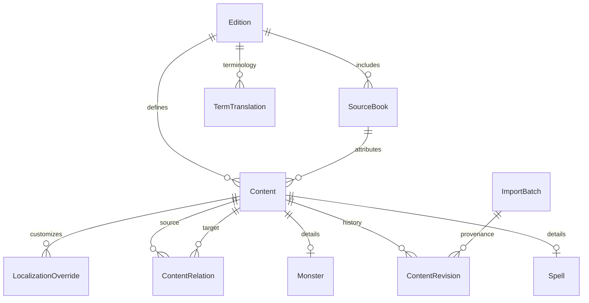

# Архитектура D&D Companion

## 1. Анализ требований

Продукт — русскоязычная локальная платформа игроков и мастеров. Текущий инкремент: **Phase 1 / Foundation**, не все шесть этапов. Требования полного продукта сохранены в `docs/MASTER_PROMPT.md`. Критические инварианты: редакции `5e_2014` и `5e_2024` в одной БД; UUID не зависят от названий; исходный текст хранится отдельно; отсутствие русского перевода не вызывает fallback; в публичном справочнике только Approved; официальный контент неизменяем из UI; импорт атомарный и не исполняет код.

## 2. Architecture Overview

Next.js App Router + React + TypeScript strict. UI → HTTP API → application services → repository/Prisma → SQLite либо PostgreSQL. Zod задаёт проверяемый контракт на границе JSON. Domain не зависит от React или ORM. В локальном режиме сервер и БД находятся на компьютере пользователя: после установки сеть не нужна. Остановка локального сервера останавливает приложение; автономная браузерная PWA и синхронизация относятся к последующим этапам.

## 3. ER Diagram

## 4. Database Design

Content — общий слой локализации, происхождения и версий; Spell и Monster — связанные 1:1 таблицы с индексируемыми полями фильтров. Сложные механические структуры — JSON, проверенный Zod; это не исполняемые выражения. Издания, книги, отношения, переводы терминов и ревизии — самостоятельные сущности. Основные индексы: редакция/тип/статус, книга, уровень/школа, опасность/тип. Ссылки защищены внешними ключами, импорт дополнительно проверяет соответствие редакции книги.

## 5. TypeScript Domain Models

Модели выводятся из Zod (`src/entities/content.ts`): EditionId, SourceBook, Content, Spell, Monster, Dataset. Discriminated union по kind исключает заклинание без Spell. TranslationStatus и ContentOrigin — конечные наборы. JSON-поля обладают предметными типами. Проекции API возвращают те же контракты. Будущие Character, Campaign и Effect добавляются отдельными модулями, без преждевременных фиктивных реализаций.

## 6. Структура каталогов

`src/app` — маршруты; `src/features` — компоненты сценариев; `src/entities` — контракты; `src/domain/rules` — игровые вычисления; `src/database` — ORM и repository; `src/services` — операции; `src/imports` — pipeline; `src/localization` — проверка и словарь; `src/search` — адаптеры; `src/tests` — проверки. `prisma` — схемы и миграции; `data/raw` — входные наборы; `scripts` — CLI; `docs` — проектирование.

## 7. Database Schema

Prisma 6 использует одинаковую логическую модель для SQLite и PostgreSQL. Каноническая схема SQLite: `prisma/schema.prisma`; PostgreSQL: `prisma/postgresql/schema.prisma`. Перенос JSON не меняет UUID. Структурные изменения требуют обеих миграций. PostgreSQL дополнительно содержит GIN-индексы русского FTS и pg_trgm.

## 8. Migration Strategy

Миграции выполняются до запуска. Уже применённые SQL-файлы не редактируются. Для обновлений используется expand → backfill → contract; резервная копия обязательна перед destructive migration. SQLite и PostgreSQL имеют разные истории SQL: смена provider не переносит данные. Перенос между БД — экспорт проверенного Dataset и импорт в новую БД. ContentRevision хранит снимок каждой импортированной версии; более старая либо конфликтующая версия отклоняется. Повтор идентичного набора идемпотентен.

## 9. Import Architecture

JSON source → parse (ограничение размера) → Zod normalization → localization audit → reference/duplicate/version checks → transaction → index. Импорт черновиков разрешён в менеджер, но не в справочник. Книги поставляются внутри набора или уже существуют. Импорт не принимает пути, архивы, HTML для исполнения или JavaScript. CSV и ZIP `.dndpack` — адаптеры Phase 5, не поддерживаются этим инкрементом. Без разрешённого SRD исходного набора официальная БД пуста; пример Homebrew явно помечен как учебный.

## 10. Localization Architecture

nameRu/descriptionRu независимы от оригинала. Validator ищет пропуски, латиницу в обязательных русских текстах, placeholders, несовпадение статуса и словарные конфликты. Системные enum отображаются через исчерпывающие русские словари. Английский оригинал виден только по настройке. Терминологические aliases участвуют в поиске. Approved с ошибкой локализации отклоняется; Missing/MachineDraft хранятся для исправления.

## 11. Rule Engine Architecture

Чистые функции и явный выбор edition, отдельные 2014/2024 модули. В Phase 1 движок представлен интерфейсом расширения; неподтверждённые механики не внедряются. Будущие эффекты должны иметь sourceId, sourceType, duration, stackingPolicy. Классовая прогрессия и различия редакций берутся из версионируемых данных, а не из UI. Соответствие редакций только через ContentRelation, никогда по имени.

## 12. План Phase 1 и критерии приёмки

1. Scaffold, типы, схемы и миграции.
2. Атомарный импорт, локализация, проверка ссылок и история.
3. Русский поиск с нормализацией Е/Ё, aliases, транслитерацией, формами и опечатками; PostgreSQL FTS adapter, SQLite local adapter.
4. UI shell, главная, заклинания, бестиарий, карточка, источники, Data Manager, настройки.
5. Unit/integration/DB tests, typecheck, lint, production build, проверка API/UI.

Phase 2–6: полный справочник → персонажи → инструменты мастера → Homebrew editors/packages → сравнение/эффекты/облако. Меню обозначает будущие этапы, не имитирует работающие функции.

## Технические первоисточники

- https://nextjs.org/docs/app/getting-started/installation
- https://docs.prisma.io/docs/orm/v6/prisma-migrate/getting-started
- https://www.postgresql.org/docs/current/textsearch.html
- https://www.postgresql.org/docs/current/pgtrgm.html
